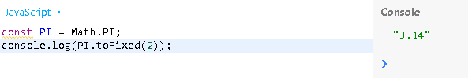
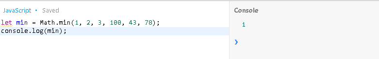
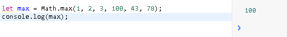
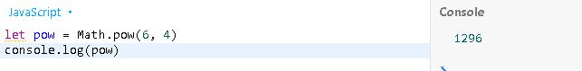
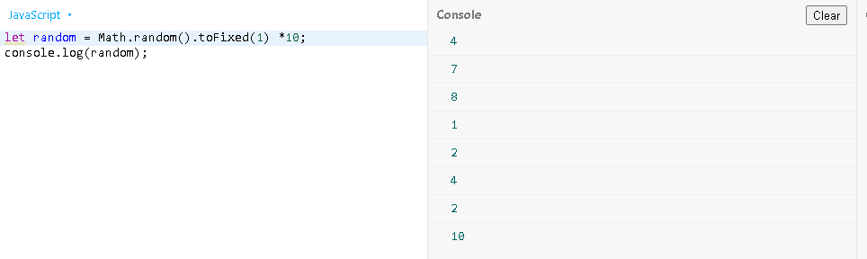

### 11/25/26

* Watched this whole video https://www.youtube.com/watch?v=93Nd8f9HU8Q by Dev Dreamer basically explainigng the most commonly used properties of math.js.

 1. The Math Property **"PI"**, the **"toFixed(2)"** displays Pi to only 2 decimal places instead of a very long number.

 For example: 


 2. **Min and Max** are used to identify the highest and lowest numbers in a list of numbers.

For example:
 

* We can see that lowest number for was 1 so thats why Math.Min gave us ! when we run it and for the high number was 100 and that's why our conole gave us 100 when we used Math.max


 3.   **Math.pow** basically finds the power of 2 numners, the first number being the base and the second number being the exponent.

For example:

* We see here that "Math.Pow" does the math for 6 to the power of 4 which gives us 1296 and we see that in our console.

4. **Math.random** generates a random number and if you use ".toFixed", you can choose where the random number comes from and in my example I made it pick random numners from 1-10.


For example:


### 11/8/26:
#### Learning Log #2
* Today I fixed my code for the calculator to work correctly, make exponents, parantheses multupication work.
* After tinkering with my tool for a long time, I have found two bugs, the exponents - ^, and multiplication - () didn't work because Javascript didn't recognize them. In order to solve this, I used the .replace method which changes certain characters in the equation, for example it turns 3(5) into 3*(5), and 3^3 turns into 3**3 so that Javascript can correctly calculate it. <br>
Code:
```js
<input id="input" oninput="out.value = eval(value.replace(/(\d)\(/g, '$1*(').replace(/\^/g, '**'))">
```  
* Now my basic calculator works correctly, and can intake, and output large amount of values.<br>

Calculator example:
<br>

* Sources used: [Mozilla](https://developer.mozilla.org/en-US/docs/Web/JavaScript/Reference/Global_Objects/String/replace).


